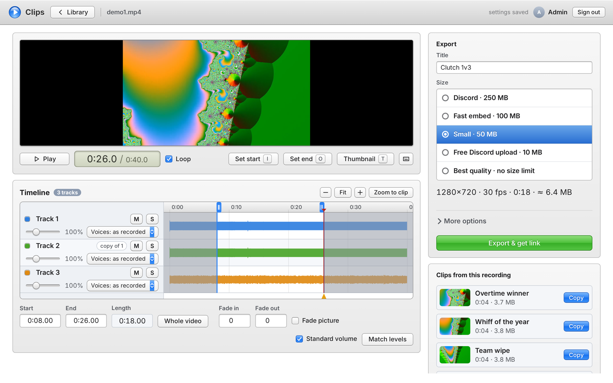

# gameclip uploading website

> 🤖 **AI-coded.** Almost all of this project (server, editor, tests, Docker setup and docs) was written by
> [Claude](https://claude.com/claude-code) (Anthropic's AI), directed and tested by [@frVasili](https://github.com/frVasili).
> See [Credits](#credits).

A small self-hosted site for game clips. Upload a recording, trim it, fix the audio, and get a link that
plays right inside Discord. Friends get their own password and their own library.

- **Trim** on a zoomable waveform timeline, pick the thumbnail frame, add fades.
- **Audio:** every track of an OBS/ShadowPlay recording separately (game, mic, Discord...), with volume up to
  400%, mute/solo, **Even out** (makes a quiet voice as loud as the others in the same track),
  **Match track levels**, and loudness normalization to −14 LUFS. All of it is previewed live.
- **Discord-ready export:** H.264/AAC MP4 under Discord's embed limit (250 MB by default; see
  [docs/discord-embeds.md](docs/discord-embeds.md)). It aims for quality, not size, so short clips stay small and embed fast.
  Smaller presets are there too (100/50/10 MB).
- **Links** like `https://clips.example.com/Xa83kd0QmP2z`: random and unguessable, so viewers can only see
  the clips they were sent.
- **Friends:** the admin creates a password per person, with a storage limit. Everyone sees only their own uploads.
  Everyone can change their own name on the **Account** tab; the admin can rename anyone on **Users & server**.
- **Big uploads** go up in pieces and resume after a dropped connection. This also gets past Cloudflare's 100 MB request limit.
- **Optional GPU encoding** (AMD/Intel VAAPI) for faster exports.
- One container, no database, nothing phones home. Plain Node + ffmpeg.



## Run it

You need Docker, and somewhere it can be reached with HTTPS if friends should use it.

```sh
mkdir clips && cd clips
curl -LO https://raw.githubusercontent.com/frVasili/gameclip-uploading-website/main/compose.yml
curl -L -o .env https://raw.githubusercontent.com/frVasili/gameclip-uploading-website/main/.env.example
# edit .env: at least ADMIN_PASSWORD and PUBLIC_URL
mkdir data && sudo chown 1000:1000 data
docker compose up -d
```

Then open the site, sign in with the admin password, and go to **Users & server** to create passwords for your friends.

**How should people reach it?**

| You have... | Use |
|---|---|
| A domain on Cloudflare | [`examples/compose.cloudflared.yml`](examples/compose.cloudflared.yml): a Cloudflare Tunnel. No open ports, your home IP stays hidden. Set `TRUST_PROXY=cloudflare`. |
| A reverse proxy already (Caddy, Nginx Proxy Manager, Traefik) | [`compose.yml`](compose.yml): the site on `127.0.0.1:8080`; point your proxy at it. Set `TRUST_PROXY=proxy`. |
| Tailscale, and only you/your tailnet will use it | [`examples/compose.tailscale.yml`](examples/compose.tailscale.yml): HTTPS on your tailnet. Discord can't load clips from a tailnet, though, so for embeds you need a public address too. |

The clip pages must be reachable from the internet for Discord embeds to work. Everything else needs a password.

### GPU encoding (optional)

For AMD or Intel graphics: set `VAAPI_DEVICE=/dev/dri/renderD128` in `.env`, then uncomment `devices` and
`group_add` in the compose file. `group_add` needs the id from `getent group render`. The admin page shows
whether it works. Exports then get a "Fast GPU encode" checkbox (ticked by default with `GPU_DEFAULT=true`): it's much faster, but needs more MB for the same
quality. (NVIDIA isn't supported yet.)

### Settings

All in `.env`; see [`.env.example`](.env.example) for the full list with explanations: site name, upload size,
per-friend storage, automatic deletion of old recordings, CPU threads, the size cap...

### Updating and backups

`docker compose pull && docker compose up -d`. Everything lives in `./data`: back that folder up. It holds users
(hashed passwords), recordings and clips.

## Security notes

- Passwords are stored as scrypt hashes; sessions are random tokens in HttpOnly cookies. Wrong passwords are
  rate limited. Each person's password must be different, because people sign in with just a password.
- Uploaded files are treated as untrusted. Only real video containers are accepted, and ffmpeg can't follow
  playlists or links inside them, because that trick can leak server files.
- The container runs as an unprivileged user with a read-only filesystem and no capabilities.
- Anyone who has a clip link can watch that clip. There is no listing, and ids can't be guessed.
- You are responsible for what your friends upload to your domain. Only hand out passwords to people you trust.

## Development

No build step and no npm dependencies. You need Node 22+ and ffmpeg on `PATH`.

```sh
ADMIN_PASSWORD=devpassword DATA_DIR=./data PORT=8080 node server/index.js
npm test        # unit tests + an end-to-end test (the end-to-end test needs ffmpeg)
```

See [AGENTS.md](AGENTS.md) for how it's put together and [docs/API.md](docs/API.md) for the API.

## Credits

- **[@frVasili](https://github.com/frVasili)**: idea, requirements, testing (including the Discord embed-limit tests), and runs it.
- **[Claude](https://github.com/claude)** (Anthropic, via [Claude Code](https://claude.com/claude-code)): wrote the code, tests and
  documentation, and ran the measurements behind the defaults (Discord embed sizes, audio leveling).
  Commits it wrote carry a `Co-Authored-By: Claude` trailer.

This is AI-written code: it has tests and was checked by hand, but read it before you trust it with anything important,
as you would any small hobby project.

## License

MIT, see [LICENSE](LICENSE).
